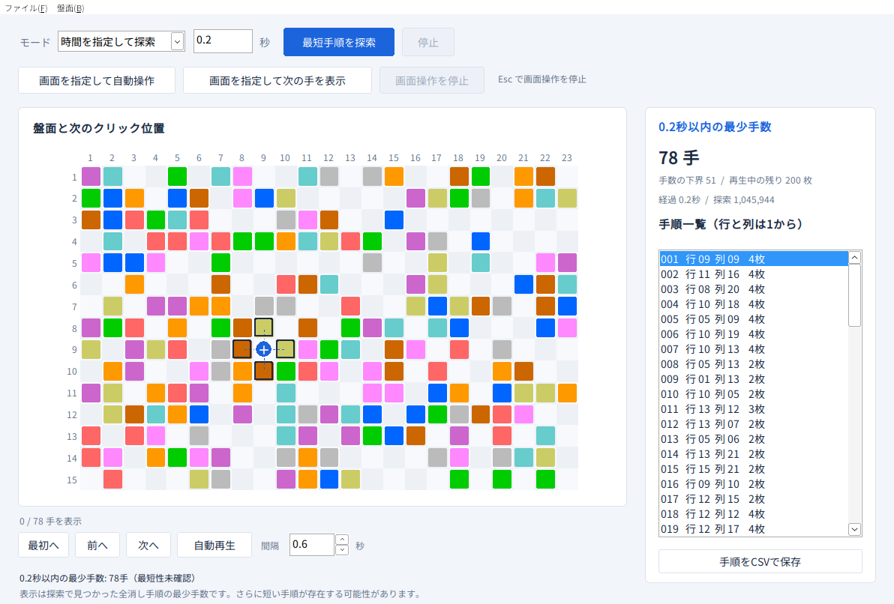

# ColorTile Solver

カラータイルのスクリーンショットから盤面を読み取り、全消しするためのクリック手順を探す Windows 用アプリです。画像認識と探索を C++17 で実装し、GUI とコマンドラインから利用できます。

**開発中です。このリポジトリではソースコードを管理しており、実行ファイルの配布・リリースはまだ行っていません。**



## できること

- PNG・JPEG・BMP などの画像から、タイルの位置と色を認識。
- 画像のドラッグ＆ドロップ、クリップボードからの貼り付け（`Ctrl+V`）。
- 認識した色の手動修正と、格子の位置・間隔の調整。
- 制限時間内の探索、または最短性を確認するまでの探索。
- 手順の前後移動、自動再生、CSV への書き出し。再生間隔は 0.1～60.0 秒を 0.1 秒単位で指定。
- 画面上で指定した盤面を読み取り、探索後に全消し手順を自動クリック。
- ゲーム画面の次のクリック位置を光らせ、手動クリック後に表示を更新。
- 盤面の `.ctb` 保存と読み込み、CLI での JSON 出力。

「自動再生」はアプリ内の盤面表示を進めます。ゲームを操作する場合は「画面を指定して自動操作」、クリック位置だけを表示する場合は「画面を指定して次の手を表示」を使います。

## ビルド

Windows 10／11 の 64 ビット環境と、C++17 に対応した **64 ビットの LLVM-MinGW または MinGW-w64** を使用します。GCC を使用する場合は C++ の `std::thread`・`std::mutex` を利用できる POSIX スレッドモデル版を選んでください。古い Win32 スレッドモデル版ではビルドできません。Windows 版のビルドは MSVC に対応していません。

### PowerShell スクリプトでビルド

コンパイラと `windres` を `PATH` に追加し、リポジトリ直下で実行します。

```powershell
.\build_windows.ps1
.\ColorTileSolver.exe
```

GUI と CLI の実行ファイルをリポジトリ直下へ生成します。アプリの実行に Python は不要です。

### CMake でビルド

CMake 3.20 以上と MinGW-w64 の `g++`、`windres`、`mingw32-make` を `PATH` に追加して実行します。

```powershell
cmake -S . -B .build -G "MinGW Makefiles" -DCMAKE_BUILD_TYPE=Release
cmake --build .build --parallel
.\.build\ColorTileSolver.exe
```

GUI で使うサンプル画像はビルド時に実行ファイルの隣へコピーされます。生成された実行ファイルやビルドフォルダは Git の管理対象外です。

Linux では CLI と共通処理のテストをビルドできます（GUI は Windows 専用）。

```bash
cmake -S . -B .build -DCMAKE_BUILD_TYPE=Release
cmake --build .build --parallel
./.build/ColorTileSolverCLI examples/sample.ctb --seconds 10 --threads 4 --output result.json
```

## 基本操作

1. ビルドした `ColorTileSolver.exe` を起動します。
2. 「ファイル」→「画像を開く」でスクリーンショットを選びます。「サンプルを開く」でも動作を試せます。`Ctrl+O`、`Ctrl+V`、画像のドラッグ＆ドロップも使用できます。
3. 「盤面」→「元画像と格子を表示」で、認識した格子と画像の位置を確認します。
4. 必要に応じて「盤面」メニューの「盤面を修正」や「認識位置を調整」で認識結果を直します。
5. 探索モードと時間を設定し、「最短手順を探索」を押します。
6. 手順一覧、前後のボタン、自動再生でクリック位置を確認します。

認識が不確かなマスには橙色の枠が表示されます。盤面を修正すると、それまでの探索結果は破棄されます。

再生ボタンの隣にある「間隔」で、自動再生の速さを変更できます。既定は 0.6 秒です。上下の矢印は 0.1 秒ずつ増減し、数値の直接入力も使用できます。再生中に変更すると、その時点から新しい間隔が適用されます。0.1 秒未満、60.0 秒超、0.1 秒刻みでない入力は受け付けず、直前の有効な値に戻します。

ファイルの読み込み、貼り付け、サンプル、盤面保存は「ファイル」メニューにまとめています。盤面保存のショートカットは `Ctrl+S` です。ウィンドウ内の重複したアプリ名とサブタイトルは表示しません。

標準の盤面は 23 列 × 15 行です。手動設定では各辺 1～32 マス、タイルは最大 256 枚に対応します。盤面の端が空白だけの場合や、画像の一部が隠れている場合は認識位置を確認してください。

## ゲーム画面で使う

### 自動クリック

1. ゲームの 23 列 × 15 行の盤面全体が、他のウィンドウに隠れず表示されるようにします。
2. このアプリで探索モード、探索時間、下部の「間隔」を設定します。
3. 「画面を指定して自動操作」を押し、盤面全体を左上から右下へドラッグします。盤面の周りに少し余白を含めても認識できます。選択中は `Esc` または右クリックで取り消せます。
4. 認識と探索が終わると、このアプリが最小化され、指定したゲームが前面になります。全消し手順が得られた場合に自動クリックを開始します。
5. 全消しを画面上でも確認すると終了し、このアプリに戻ります。

途中で止めるには **Esc** を押します。F8 でも停止できます。アプリを前面に戻した場合も、ゲームが前面でなくなった時点で停止します。探索中は「画面操作を停止」または通常の「停止」でも中止できます。

自動クリックは各手の前に盤面を読み取り、クリック後に予定したタイルが消えたことを確認してから次へ進みます。「間隔」はクリック間隔の下限で、画面更新と確認にかかる時間によって長くなります。クリック後の変化を 2 秒以内に確認できなければ停止し、同じクリックを再送しません。

### 次の手を光らせる

「画面を指定して次の手を表示」を押し、同じ方法で盤面を選びます。探索後にゲーム画面の次のクリック位置へ黄色いリングが表示されます。リングはクリックを通すので、その位置をそのまま手動でクリックできます。予定した盤面の変化を確認すると、次の位置へリングが移ります。このモードは自動クリックを送りません。終了方法は自動操作と同じです。

### 画面操作の条件

標準の色の盤面を、通常のウィンドウ表示で使用してください。ウィンドウの移動やサイズ変更、画面構成の変更、他のウィンドウの重なり、前面ウィンドウの変更、予定外の盤面変化を検出すると停止します。ゲームのタブ移動やスクロールで盤面が動いた場合も、読み取った盤面が一致しなくなれば停止します。再開する場合は盤面の範囲を指定し直してください。

認識が不確かな場合、格子の位置が曖昧な場合、部分手順しか見つからなかった場合には、画面操作を開始しません。ゲーム側のアニメーションや終了表示によって最終状態が隠れる場合、全消し確認前に停止することがあります。最短性が未確認の全消し手順は、その状態を維持して表示します。

Windows が前面化や入力を拒否するウィンドウ、管理者権限のゲーム、保護された画面への入力は対応しません。アプリを管理者権限で起動する必要はありません。画面取得と操作はローカルで行い、ネットワークへ送信しません。

## 探索結果の読み方

「時間を指定して探索」は、指定した時間内に見つかった全消し手順のうち、最も少ない手数を保持します。既定は 10 秒で、0.1～86,400 秒を指定できます。「最短確定まで探索」は時間制限を設けず、より短い全消し手順が存在しないことを確認するまで探索します。途中で停止した場合も、その時点の手順を保持します。

| 表示 | 意味 |
|---|---|
| 最短確定 | 全消しでき、これより少ないクリック数の手順がないと証明済み。 |
| 最短性未確認／全消し暫定解 | 全消しできるが、さらに短い手順が存在する可能性あり。 |
| 時間内に全消し未発見 | 時間内に手順が見つからなかった状態。全消し不能の証明ではありません。 |
| 全消し不能 | 認識した盤面について、全消し手順がないと判定。認識結果も確認してください。 |

最短の基準はクリック回数です。マウス移動距離や実ゲームの操作時間は最適化しません。「下界」は少なくとも必要になるクリック数で、見つかった全消し手数と一致すると最短性を確定できます。

大きな盤面では、全消し手順が見つかっても最短性の証明に時間がかかります。制限時間内に全消しや最短性の証明を必ず達成できる保証はありません。並列探索では同じ時間設定でも結果が変わる場合があります。

## コマンドライン版

```powershell
.\.build\ColorTileSolverCLI.exe .\examples\sample.ctb --seconds 10 --threads 4 --output result.json
```

PowerShell スクリプトでビルドした場合は `.build\` を省き、`.\ColorTileSolverCLI.exe` を使用します。`--seconds 0` は時間無制限です。

JSON の `status` が `optimal` の場合のみ最短性が証明済みです。`feasible` は全消し手順があるものの、最短性は未証明です。行・列は 1 から数えます。GUI の CSV 出力に含まれる座標は読み込んだ画像内の座標です。

`.ctb` は先頭に幅と高さ、続いてマスの色番号を並べたテキスト形式です。`0` は空白、`1`～`10` は順に灰・青・水色・緑・黄・茶・橙・赤・桃・紫です。具体例は [sample.ctb](examples/sample.ctb) を参照してください。

## テスト

ビルド後、共通処理のテストを実行できます。

```powershell
ctest --test-dir .build --output-on-failure
```

探索結果を独立した参照探索と比較するテスト、3×3 盤面の全組合せなどを調べるテスト、画像認識の入力検証を実行します。

スクリーンショットの拡大縮小・余白・JPEG 圧縮などの認識テストには、追加で Python と Pillow が必要です。アプリの実行には不要です。

```powershell
python -m pip install Pillow
python tests/test_recognition.py --driver .build/test_recognition.exe
```

Linux ではドライバーのパスを `.build/test_recognition` に置き換えてください。

Windows GUI の起動・停止・手順移動・探索中の終了も、次のテストで確認できます。実行中はアプリのウィンドウが開きます。

```powershell
.\.build\test_gui_windows.exe "$PWD\.build\ColorTileSolver.exe" "$PWD\examples\sample.png"
```

画面操作のテストは、専用のゲームウィンドウを起動して実際のクリック入力を確認します。実行中はマウスと前面ウィンドウを操作するため、他の作業をしないテスト用デスクトップで実行してください。

```powershell
.\.build\test_desktop_windows.exe "$PWD\examples\sample.ctb"
.\.build\test_screen_gui_windows.exe "$PWD\.build\ColorTileSolver.exe" "$PWD\.build\test_desktop_windows.exe" "$PWD\examples\sample.ctb"
```

`test_live_playback` は画面を操作せず、盤面確認、クリック間隔、無応答時の停止、手動ヒントの進行を検証します。これは `ctest` に含まれます。

過去の検証条件と結果は [検証レポート](docs/TEST_REPORT.md) を参照してください。実行環境や所要時間の記録は、その検証時点のものです。

## フォルダ構成

| パス | 内容 |
|---|---|
| `src/` | 探索・画像認識・CLI・Windows GUI とリソース。 |
| `tests/` | 参照探索との比較、画像認識、Windows GUI のテスト。 |
| `examples/` | サンプル画像、盤面データ（`.ctb`・JSON）と画面例。 |
| `docs/` | 検証レポート。 |
| `licenses/` | コンパイラ・実行時ライブラリのライセンス。 |
| `CMakeLists.txt` | アプリとテストのビルド定義。 |
| `build_windows.ps1` | Windows 用の簡易ビルドスクリプト。 |

実行ファイル、ライブラリ、アーカイブ、ビルド中間生成物はコミットしません。画像とアイコンはアプリのリソースおよびテスト入力として管理します。

## ライセンス・参考

独自実装のソースコードは [MIT License](LICENSE.txt) です。コンパイラの実行時ライブラリとサンプル画像に関する注意事項は [THIRD_PARTY_NOTICES.txt](THIRD_PARTY_NOTICES.txt) を参照してください。サンプル画像のゲーム素材をソースコードと同じライセンスで再許諾するものではありません。

ルールは [ゲーム菜園の説明](https://www.gamesaien.com/game/color_tiles/guide/) を参考にしています。検討時に [xkikeg/colortile](https://github.com/xkikeg/colortile) を参照していますが、このアプリのコードは独立して実装しています。
